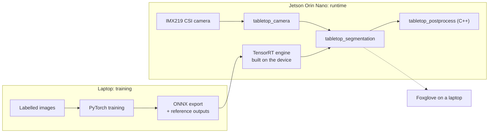

# tabletop-perception

> **Work in progress.** This repository is being built in the open alongside an article series. Code, structure and instructions will change until the accompanying article is published.

Real-time semantic segmentation of tabletop scenes on an NVIDIA Jetson Orin Nano: from a CSI camera, through ROS 2, to a TensorRT engine, with every hand-over between stages measured and verified.

## What this project builds

A camera looks at a table. On the Jetson, a ROS 2 pipeline captures frames, runs a segmentation network that labels every pixel, and publishes the result, all within the 33 ms that a 30 fps camera allows per frame.

The model is trained on a laptop, exported to ONNX, and compiled into a TensorRT engine on the Jetson itself.

**Why a table?** The next project in the series puts a robot arm on the same table. Knowing where objects are, and how quickly the system can tell, is the first thing a manipulation system needs.

## Pipeline



## Approach

### Two datasets, two purposes

1. **Oxford-IIIT Pet** is a public dataset with well-studied results. It serves as a known-answer test for the training code: a pipeline that can't learn a familiar task won't learn a new one. The model trained on it also stands in while the deployment chain is built and verified.
2. **Own tabletop images**, captured with the same camera that runs at deployment and labelled against written labelling rules. This is the model the robot arm will use.

### Engineering principles

- **Verify every hand-over.** PyTorch, ONNX Runtime and TensorRT are compared on the same inputs. Reference files with content hashes travel with the model from the laptop to the Jetson.
- **One preprocessing contract.** Training and deployment must prepare images identically. Differences in colour order, resizing or normalisation are measured.
- **Measure at every boundary.** Each stage reports its own timing, so a slowdown or a lost frame can be traced to the layer that caused it.
- **Work against a budget.** Every stage's cost is reported against the 33 ms frame budget, which decides where optimisation effort goes.
- **Reproducible by default.** A locked Python environment, fixed data splits, and engines built on the target device.

## Scope

| Area | Topics |
|---|---|
| Capture | CSI camera, sensor modes, image signal processor, GStreamer, camera calibration |
| ROS 2 | Nodes in Python and C++, parameters, QoS, launch files, rosbag recording, Foxglove |
| Training | A hand-written PyTorch training loop, transfer learning, IoU and Dice metrics |
| Deployment | ONNX export, TensorRT FP32 and FP16, parity checks across runtimes |
| Performance | Per-stage latency against the frame budget, transport of large messages |
| Packaging | Docker |

## Hardware and software

| | |
|---|---|
| Edge device | NVIDIA Jetson Orin Nano 8 GB Developer Kit |
| Camera | Sony IMX219 8 MP CSI camera, 77° lens, 22-pin cable |
| Jetson software | JetPack 7.2.1 (Ubuntu 24.04), TensorRT 10.16, ROS 2 Jazzy |
| Training machine | Apple Silicon laptop, PyTorch on the MPS backend |
| Python | 3.12 on both machines; training environment managed with `uv` |
| Visualisation | Foxglove, connected to the Jetson over Tailscale |

## Repository layout

```
tabletop-perception/
├── training/        # PyTorch data pipeline, model, training, evaluation and ONNX export (laptop)
├── ros2_ws/src/     # ROS 2 packages (Jetson)
│   ├── tabletop_camera/         # CSI camera capture and publishing
│   ├── tabletop_segmentation/   # Preprocessing and TensorRT inference
│   ├── tabletop_postprocess/    # Mask post-processing in C++
│   └── tabletop_bringup/        # Launch files and configuration
├── deploy/          # Jetson tools outside ROS, such as engine parity checks
├── docker/          # Container packaging
├── docs/            # Notes and figures
└── results/         # Small files behind the published numbers
```

Datasets, checkpoints, ONNX models and TensorRT engines are not stored in git. TensorRT engines depend on the exact TensorRT version and GPU, so they are always built on the target device. Trained weights will be published with the article.

## Part of a series

This is the third project in a series on running AI on edge hardware for Physical AI, written up at [davidvincze.com](https://davidvincze.com):

1. [Edge Inference Benchmark Lab: FP32 vs FP16 vs INT8 on Jetson Orin Nano](https://davidvincze.com/posts/edge-inference-benchmark-lab/) ([repository](https://github.com/vdavid21/edge-inference-benchmark-lab))
2. [Building an Interruptible Voice Runtime on NVIDIA Jetson](https://davidvincze.com/posts/interruptible-voice-runtime/) ([repository](https://github.com/vdavid21/interruptible-voice-runtime))
3. **tabletop-perception** (this repository)

## License

MIT. See [LICENSE](LICENSE).
